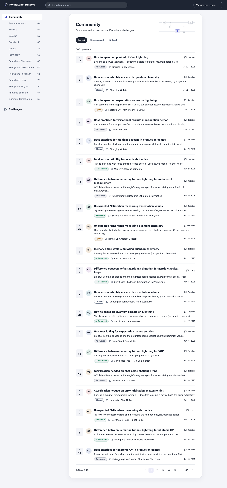
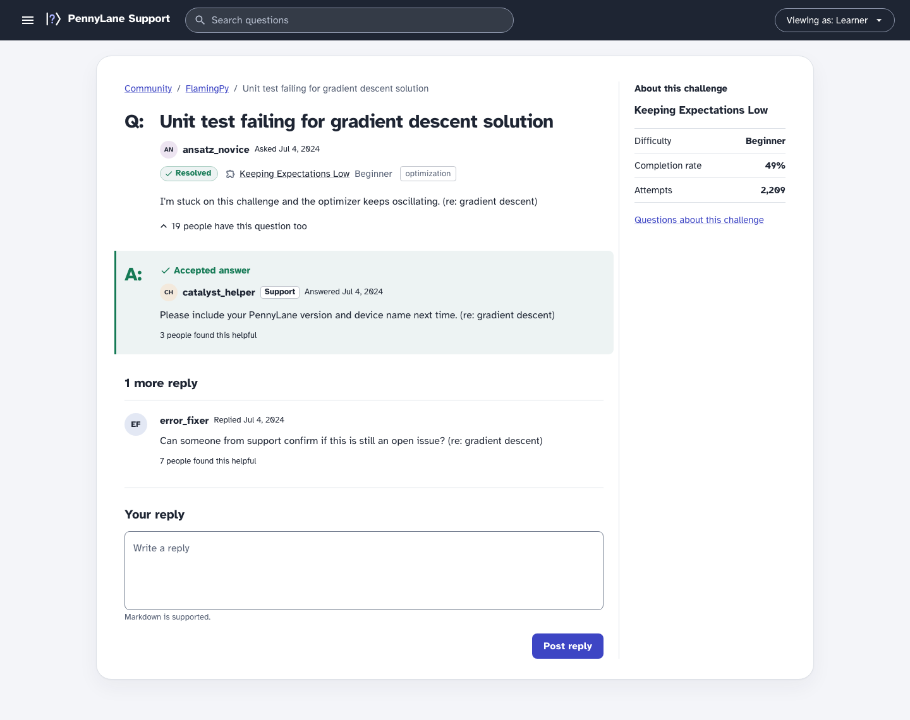
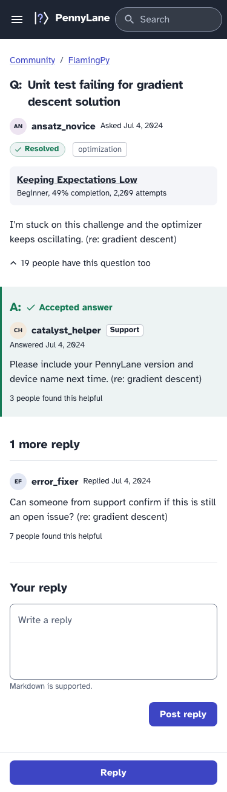

# PennyLane Support

A support platform for PennyLane coding challenges, built as a frontend proof of concept. Learners browse challenges, search questions and reply to threads; an admin changes a thread's status and sees where learners get stuck.

There is no backend. The app makes real HTTP requests, and a mock server that runs inside the browser answers them from the two JSON files in [`data/`](data/).

| Community list (1440 px)                                                                                | Thread (1440 px)                                                                                                                                    | Thread (375 px)                                                                                                   |
| ------------------------------------------------------------------------------------------------------- | --------------------------------------------------------------------------------------------------------------------------------------------------- | ----------------------------------------------------------------------------------------------------------------- |
|  |  |  |

The Challenges and Insights screens are in [`docs/screenshots/`](docs/screenshots/), each at 1440 px and 375 px.

## Setup and scripts

Node `^22.13.0 || ^24.0.0 || >=26.0.0` (the `engines` field in `package.json`). [`.nvmrc`](.nvmrc) names Node 24, so `nvm use` picks it.

```sh
npm install
npm run dev
```

Vite prints the address to open.

| Command               | What it does                                                    |
| --------------------- | --------------------------------------------------------------- |
| `npm run dev`         | Starts the app with the mock server                             |
| `npm run build`       | Type-checks, then builds to `dist/`                             |
| `npm test`            | Unit and component tests (Vitest)                               |
| `npm run test:e2e`    | End-to-end flow and accessibility checks (Playwright, Chromium) |
| `npm run screenshots` | Retakes the eight images in `docs/screenshots/`                 |
| `npm run lint`        | ESLint; a warning fails the run                                 |
| `npm run typecheck`   | TypeScript only, no build output                                |
| `npm run check`       | `lint`, `typecheck` and `test` in one run                       |
| `npm run format`      | Prettier, rewrites files in place                               |

The two Playwright scripts start their own dev server on port 5174. They need Playwright's Chromium browser, which `npm install` does not download. Install it once:

```sh
npx playwright install chromium
```

## How to try it

The role switcher is the "Viewing as" button in the top bar. Below 900 px it sits in the menu that the ☰ button opens. The role is remembered across reloads. Replies and status changes are kept in memory and reset on reload.

**As a learner**

1. Type `gradient` in the search field, then pick the **Unanswered** tab. The count line updates, and the address holds `q=gradient` and `tab=unanswered`, so the view can be shared or bookmarked.
2. Open a question. The accepted answer sits directly under the question, marked **A:**, before the other replies.
3. Write a reply and post it. It appears at the end of the thread as a reply by "you".
4. Open **Challenges** and click a card. The Community list opens filtered to that challenge, shown as a chip you can remove.
5. Get refused: open `/insights`. The page says "Insights are for admins", and the sidebar has no Insights link. The server refuses too. Paste this in the browser console and it prints `403`:

   ```js
   fetch("/api/insights", { headers: { "X-Mock-Role": "learner" } }).then((r) => console.log(r.status));
   ```

**As an admin**

1. A fourth tab appears: **Needs attention**. It lists the 47 open threads that are unassigned or have high or urgent priority. Each row now shows priority and assignee.
2. Open a thread and use the **⋯** button ("Manage thread") to change its status. The chip updates after the server answers.
3. Open **Insights**. Four figures come first: 128 open conversations of 800, 30 open and unassigned, a median of 63.7 hours to resolve, and 357 threads with an accepted answer. Each row under "Where learners struggle" links to that challenge's unanswered questions. "Show as table" gives the chart's values as a table.
4. While on Needs attention, switch back to Learner. The tab disappears and the list returns to Latest.

## How it works

Every read and write follows the same path:

1. **URL.** Search, category, tab, challenge filter and page live in the URL's search params. React Router reads them.
2. **Hook.** The page calls a TanStack Query hook from `src/api/hooks/`. TanStack Query is a library that caches server data and tracks loading and error states.
3. **Fetch.** The hook calls `apiGet` or `apiSend` in [`src/api/http.ts`](src/api/http.ts). These make a real `fetch("/api/...")` and send the viewer's role in an `X-Mock-Role` header.
4. **MSW handler.** MSW (Mock Service Worker) intercepts the app's network requests in the browser and answers them like a server would. The handlers in `src/mocks/handlers/` parse the request and return a status code and JSON.
5. **Permission check.** The handler asks `can(role, action, context)` in [`src/domain/permissions.ts`](src/domain/permissions.ts) and answers 403 if the role may not do it. The UI calls the same function to hide controls, so there is one set of rules.
6. **Query.** The handler calls a pure function in `src/mocks/queries/` that filters, sorts, pages or aggregates.
7. **In-memory data.** The function reads a store that is built once from the JSON files, after normalization (see [The data](#the-data)).


A real backend would replace `src/mocks/` and the one function in [`src/app/main.tsx`](src/app/main.tsx) that starts the mock worker; no component or hook imports from `mocks/`.

The endpoints are listed in the [mock API contract](docs/requirements.md#mock-api-contract).

## Key decisions

[DECISIONS.md](DECISIONS.md) records every choice, what I rejected and why. These are the ones that shaped the app most:

- **The mock server does the filtering, sorting and paging**, not the browser. The UI only ever holds one page, so it would work unchanged on a larger dataset. ([D5](DECISIONS.md#d5))
- **MSW instead of importing the JSON directly.** The app makes real `fetch` calls and handles real status codes (400, 403, 404, 409). The same handlers run in the tests. ([D7](DECISIONS.md#d7))
- **Two viewer roles, learner and admin.** Mentor, staff and support stay as badges on posts. One function holds the permissions, and both the UI and the mock server call it. ([D2](DECISIONS.md#d2))
- **List state lives in the URL.** A filtered view can be shared, and the Back button works. ([D9](DECISIONS.md#d9))
- **Answer-first threads.** The accepted answer sits directly under the question, because a learner arrives to find the answer. ([D18](DECISIONS.md#d18))
- **Pending state, then refetch, for data changes.** The server can refuse a change, so I did not use optimistic updates, which show a change first and undo it on refusal. ([D14](DECISIONS.md#d14))
- **The role is part of every cache key.** The server answers each role differently, so one role's cached answer is never shown to the other. ([D44](DECISIONS.md#d44))

## The data

The brief's data is 120 challenges and 800 conversations with 3,061 posts. It has inconsistencies. Normalization fixes them once, when the mock store loads, in [`src/domain/normalize.ts`](src/domain/normalize.ts). The raw files are never edited.

| What was messy                                          | Size                                     | What normalization does                                                                                                                             |
| ------------------------------------------------------- | ---------------------------------------- | --------------------------------------------------------------------------------------------------------------------------------------------------- |
| Posts are not in time order                             | 449 of 800 conversations                 | Sorts the replies by timestamp, then by `post_id` on a tie                                                                                          |
| A reply is dated before the question                    | 220 conversations                        | Keeps `post_id` 1 as the opening post; never picks it by timestamp                                                                                  |
| `last_activity_at` is wrong                             | 267 conversations                        | Recomputes it from the latest post                                                                                                                  |
| Descriptions restate status, priority or an internal ID | Status and priority in 333, an ID in 521 | Strips those lines. Priority is admin only and search reads the description, so a learner could otherwise find urgent threads by searching "urgent" |
| Description missing                                     | 60 conversations                         | Falls back to the opening post's text                                                                                                               |
| `points` stored as a string                             | 1 challenge                              | Converts it to a number                                                                                                                             |
| Titles repeat                                           | 723 of 800 conversations share a title   | Keys everything on IDs; no internal ID is shown on screen                                                                                           |

Some values are kept as given on purpose. A thread with status "answered" and no accepted answer (105) stays "answered", and the thread page says "No accepted answer". Text a learner typed is never rewritten.

The full list of findings and rules is in [requirements.md](docs/requirements.md#data-findings-and-normalization-rules).

## Accessibility

The target is WCAG 2.2 AA.

**Checked automatically**

- **axe in component tests.** axe is a library that finds accessibility errors in rendered HTML, such as a control without a label. The five screen-level test files (the app shell and the four pages) each assert no violations. These tests run in jsdom, a simulated browser that does not paint, so the colour-contrast rule is off there.
- **axe in Playwright.** A real browser opens the four screens as a learner and as an admin, eight checks in all, with the WCAG 2.0 to 2.2 A and AA rules. Colour contrast is included here.
- **Contrast ratios.** I checked each text and status colour pair against 4.5:1, and control borders and focus rings against 3:1. The ratios are recorded in DECISIONS.md ([D50](DECISIONS.md#d50), [D56](DECISIONS.md#d56), [D64](DECISIONS.md#d64), [D67](DECISIONS.md#d67), [D69](DECISIONS.md#d69), [D71](DECISIONS.md#d71)).

**Checked by hand**

Reviewing each screen in the browser found problems the automated checks missed. Each one is fixed:

- Keyboard: the skip link stopped under the sticky top bar, and `main` took focus without showing a focus ring. ([D63](DECISIONS.md#d63))
- Keyboard: a new page of the list left the viewer at the bottom. The top of the page now takes focus when the rows arrive. ([D63](DECISIONS.md#d63))
- 375 px: the search field was cut to four letters. ([History, Oct 9](DECISIONS.md#history))
- Focus ring: the action-blue ring did not show on the dark top bar (2.08:1). The bar uses a light accent instead (7.62:1). ([D56](DECISIONS.md#d56))
- 200% zoom: I checked every screen at 200% browser zoom and found no problems.

## Testing

`npm test` runs 122 tests in 17 files. `npm run test:e2e` runs 9.

| Layer              | Where                                                                      | What it covers                                                                                                                                                                              |
| ------------------ | -------------------------------------------------------------------------- | ------------------------------------------------------------------------------------------------------------------------------------------------------------------------------------------- |
| Unit: domain       | `src/domain/__tests__/`                                                    | Each normalization rule, plus invariants over all 800 real conversations; the permission rules                                                                                              |
| Unit: mock queries | `src/mocks/queries/__tests__/`                                             | Tabs, search, ordering, paging, replies, insights and challenge grouping, on small fixtures. One file runs on the real data and pins the tab totals (128, 294, 47) and the insights figures |
| Handlers           | `src/mocks/handlers/__tests__/`                                            | Status codes (400, 403, 404, 409) and what each role gets back                                                                                                                              |
| Components         | `src/app/__tests__/`, `src/pages/*/__tests__/`, `src/api/hooks/__tests__/` | Each screen rendered through the real MSW handlers, not mocked hooks: filtering, replying, role gating, the status change, and an axe check                                                 |
| End to end         | `tests/e2e/`                                                               | One flow in Chromium (search, pick a tab, open a thread, reply) and axe on every screen for both roles                                                                                      |

I test one thing per distinct way the code can break, and do not pin documented counts except in the one real-data file ([D38](DECISIONS.md#d38)).

## How I used AI

I built this with Claude Code. I made the product and technical decisions and reviewed every change.

**How I kept control**

- **Written rules.** [AGENTS.md](AGENTS.md) holds the stack, folder structure, architecture rules, data rules and working agreement. [CLAUDE.md](CLAUDE.md) only imports it, so any coding agent reads the same rules ([D22](DECISIONS.md#d22)).
- **A plan for every slice.** A slice is one small piece of work that ends in one commit. Before each one, the agent listed the files it would touch and the tests it would add, and waited for my approval.
- **Review before every commit.** After `npm run check` passed, the agent gave me a reading guide (the files to read first, and how a request flows through them) and a proposed commit message. I read the diff, tried the screen in the browser, and only then approved.
- **Rules enforced by tools.** ESLint holds the code-style rules, so they do not drift ([D37](DECISIONS.md#d37)).

**What I changed or rejected**

- **A wrong data rule, caught before any code.** The first plan picked the opening post by earliest timestamp. A data check showed that this made a reply the question in 220 conversations. The rule became "`post_id` 1". ([D35](DECISIONS.md#d35))
- **A planning review before coding.** Reading the documents against the wireframes and the data turned up 28 gaps and conflicts. I resolved each one in the documents first. ([History, Oct 8](DECISIONS.md#history))
- **The first Community list was redone.** It was structurally right but read as a wireframe with real data. The visual layer was rebuilt, and review in the browser found seven more problems, all fixed. ([D61](DECISIONS.md#d61), [History, Oct 9](DECISIONS.md#history))
- **Fewer, sharper tests.** I narrowed the test scope to one test per distinct way the code can break: 23 tests that each name one failure, instead of 54. ([D38](DECISIONS.md#d38))
- **A chart became a list.** "Where learners struggle" was drawn as a chart. A chart cannot hold links, so it became a ranked list where every row leads to its questions. The monthly chart gained "Show as table" in review. ([D69](DECISIONS.md#d69))
- **Measured before memoizing.** A status change re-rendered all six post bodies on a six-post thread. Wrapping three components in `memo` brought that to zero. I rejected adding the React Compiler for it. ([D68](DECISIONS.md#d68))
- **Code that could not run yet was left out.** A Markdown stripper for list excerpts was proposed. All 800 opening posts are plain text, so I deferred it. ([D24](DECISIONS.md#d24))

## What's next

The support system is the primary focus, so I built its core first: the list, the thread, replying and one server-enforced admin action. The deferred items below repeat a pattern the app already shows (another filter, another admin action, another chart). The reasoning is in [D53](DECISIONS.md#d53) and the [cut list](docs/requirements.md#cut-list-risks-and-sources).

**Deferred**

- More filters on the Community list: tag, a challenge picker, and priority and assignee for the admin. The mock server already filters by tag, priority and assignee, with tests.
- Admin actions beyond the status change: assign, set priority, pin and lock. `can()` already holds their rules, with tests.
- Learners marking an accepted answer or marking their own thread solved, with a signed-in demo learner.
- Asking a new question, with the challenge's hints and similar threads shown first.
- Related threads and the challenge's hints in the thread rail.
- A challenge detail page, and a difficulty filter on the Challenges page.
- Two more Insights charts: conversations by status, and median resolution time by category.
- Keeping changes across a reload (`sessionStorage`).

**Out of scope for a proof of concept**

- Authentication.
- Working votes and helpful counts (display only today).
- A moderator role between learner and admin.
- Search on the Challenges page.
- A dark theme.

## Known trade-offs

**Simplified because this is a proof of concept**

| What                                                       | Where                                                     | What it means                                                                                                                                                      |
| ---------------------------------------------------------- | --------------------------------------------------------- | ------------------------------------------------------------------------------------------------------------------------------------------------------------------ |
| Data lives in memory                                       | `src/mocks/db/store.ts`                                   | Replies and status changes reset on reload                                                                                                                         |
| The role is a request header, not a login                  | `src/api/http.ts`, `src/mocks/handlers/viewerRole.ts`     | Anyone can send `X-Mock-Role: admin`. The permission checks are real; the identity is not. A missing or unknown role counts as a learner ([D43](DECISIONS.md#d43)) |
| No user accounts                                           | `src/mocks/queries/addReply.ts`                           | Every reply written in the app is by "you" ([D65](DECISIONS.md#d65))                                                                                               |
| The mock server ships in the production build              | `src/app/main.tsx`                                        | Without it a built app would be empty ([D45](DECISIONS.md#d45))                                                                                                    |
| The API contract is wider than the build                   | [requirements.md](docs/requirements.md#mock-api-contract) | Some documented endpoints and fields are designed but not built                                                                                                    |
| Search is a plain substring match on title and description | `src/mocks/queries/listConversations.ts`                  | No ranking, no typo tolerance                                                                                                                                      |
| End-to-end tests run in Chromium only                      | `playwright.config.ts`                                    | Firefox and WebKit are not covered ([D72](DECISIONS.md#d72))                                                                                                       |
| Dates are shown as given                                   | `src/domain/normalize.ts`                                 | 220 threads show a reply dated before the question ([D35](DECISIONS.md#d35))                                                                                       |

**Code I would still clean up**

- **The focus-ring literal is repeated.** `theme.ts` defines a `focusRing` object but does not export it. The same `2px solid` outline is written again in `ConversationRow.styles.ts`, `AppLayout.tsx`, `MonthlyChart.tsx` and `Insights.styles.ts`. It should be one exported token.
- **No code splitting.** `npm run build` warns about two chunks over 500 kB: the app, and the mock server with its data. Lazy-loading the routes would split the first.
- **The role's storage key is written twice.** Once in `src/providers/role/RoleProvider.tsx` and once in `tests/e2e/support.ts`.
- **`can()` holds rules for actions no screen offers yet** (assign, pin, lock, accept answer). They are tested, but unused until the deferred work is built.
- **The wireframes are out of date.** They were drawn before the prioritization and still show deferred features. Where a wireframe and the text disagree, the text wins.
