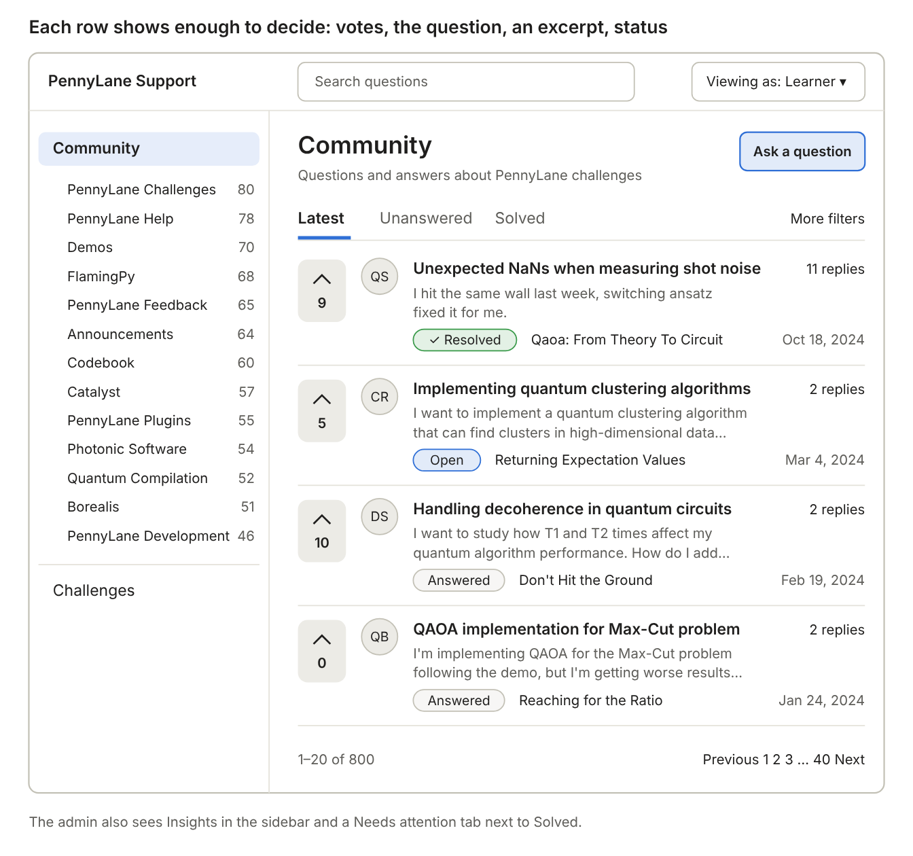
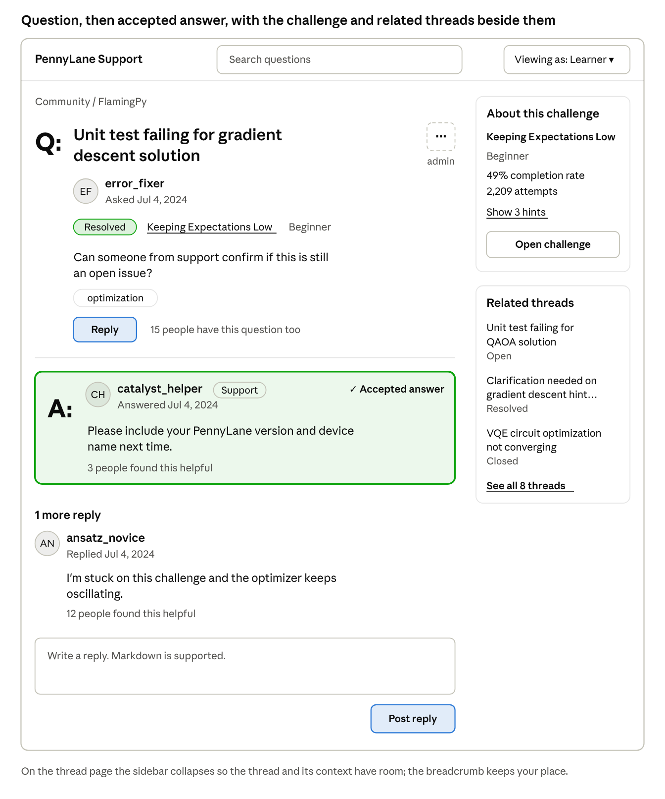
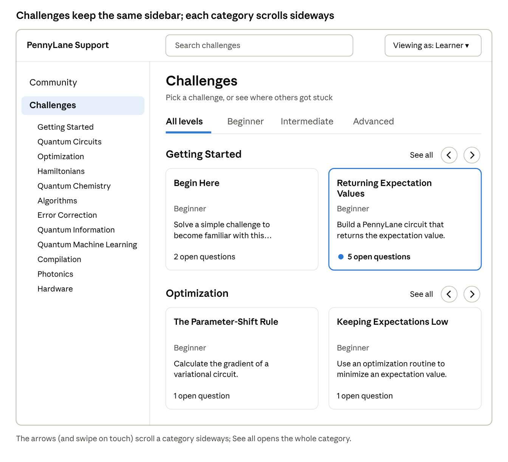
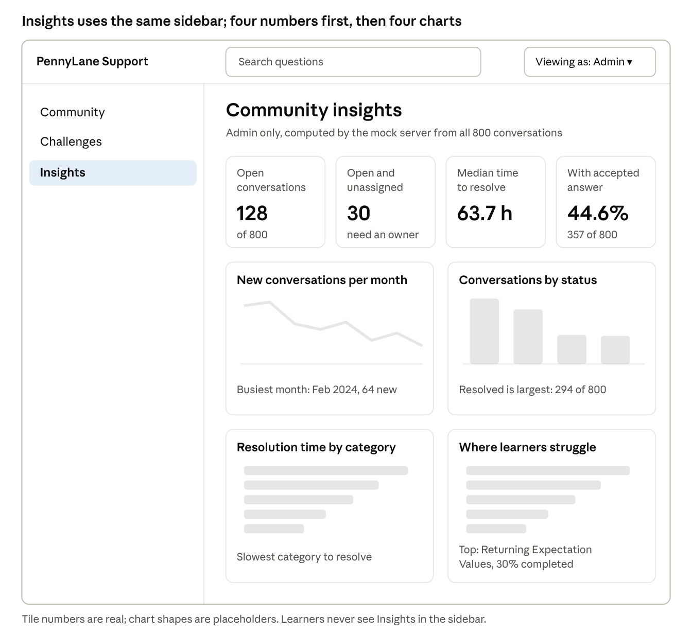
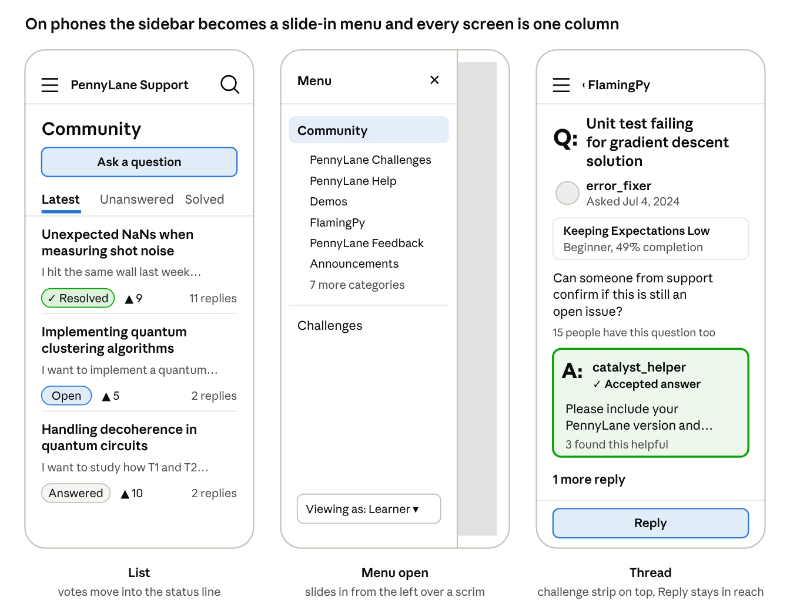
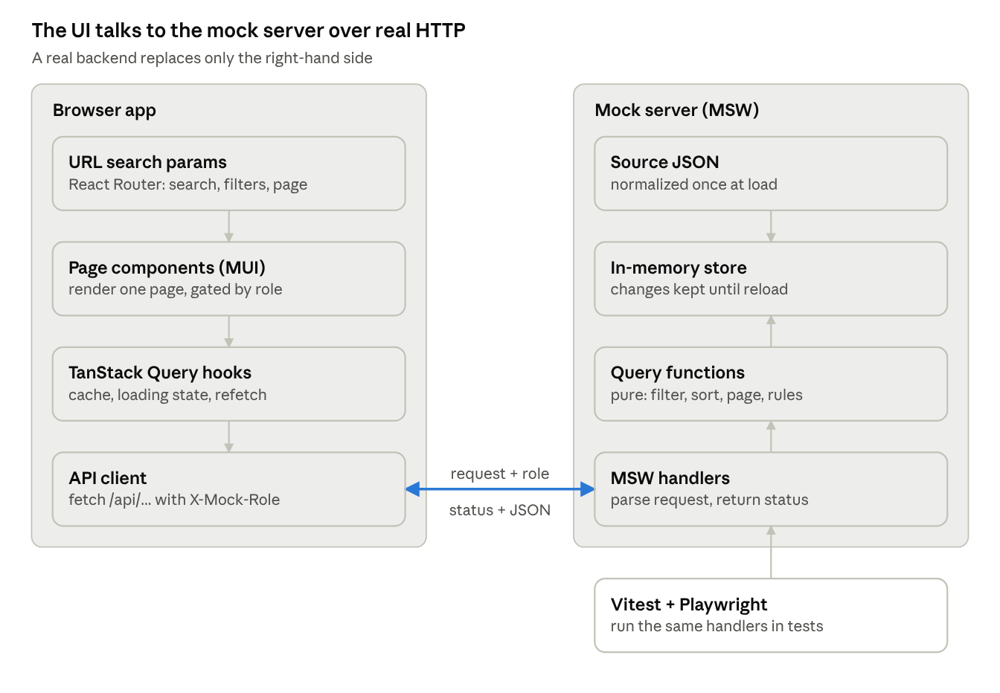

# PennyLane Support — Requirements & Roadmap

Florian · started Oct 6, 2026 · last updated Oct 8, 2026

> Source of truth for *what* to build. Agent rules live in `AGENTS.md`; the decision history lives in `DECISIONS.md`. Requirement IDs (FR-n, NFR-n) are referenced from commits and test names.

A learner-first support platform for PennyLane coding challenges, built as a proof of concept for Xanadu's take-home technical assessment, due Oct 9, 2026 at 5:00 PM Eastern (Toronto time).

## Goal and constraints

Build a small, well-reasoned support platform: learners browse challenges and help each other in conversations, and an admin moderates those conversations and sees where learners get stuck. It is a proof of concept. Success means every decision is defensible at the panel, not that every feature exists.

**Brief requirements** (from the take-home brief):

- Clean, efficient UI/UX for accessing the platform with the provided data
- Real-looking APIs, mocked in frontend code
- Browse challenges and manage support conversations, with the support system as the primary focus
- A data-visualization page with high-level insights for an admin
- GitHub repo with setup and run instructions
- Incremental, AI-assisted commits that show the thought process; the work must be defensible to the panel

**Constraints**

| Constraint | Value |
| --- | --- |
| Deadline | Friday Oct 9, 5:00 PM Eastern (Toronto time) |
| Data | 120 challenges, 800 conversations, 3,061 posts |
| Scope guidance | Intentionally open; decisions are part of the assessment |
| Tooling | Claude Code for implementation |

**Success criteria**

- A fresh clone runs with `npm install` and `npm run dev`
- Each role can be demoed in under a minute
- Tests pass and cover the data rules, the mock server and the key interactions
- README and decision log explain every assumption and trade-off

## Decision log

Diego confirmed scope, roles and data scale were left open on purpose, so each choice below records what was rejected and why. `DECISIONS.md` repeats this table and adds the history of how each choice changed.

| Area | Decision | Rejected | Why |
| --- | --- | --- | --- |
| Primary user | Learner-first community; the admin moderates on the same screens | Staff triage inbox; separate learner and staff areas | The brief says the platform "enables learners to seek help, share knowledge". One set of screens fits the time. |
| Roles | Two viewer roles: learner and admin. Mentor, staff and support stay as badges on posts | Four roles from the data; single mock user; fake login | The brief names learners and an admin. Extra roles cluttered every screen. Permissions live in one table, so a moderator role later is one new row, not new screens. |
| Navigation | A labelled left sidebar: Community with its 13 categories, then Challenges, plus Insights for the admin | Challenge-first navigation; top tabs; an icon-only rail | The brief makes support the primary focus, so threads are home. Every challenge card leads into its threads. Categories become a browsing path, as on the real forum, and labels keep navigation accessible. |
| Design reference | Content model from the PennyLane forum and challenges page; design inspiration for layout patterns from the PennyLane forum and various online forums | Copying an existing layout; a generic admin dashboard | The data mirrors both real products. Today help and challenges live on separate sites; connecting them is the improvement. |
| Data scale | Server-style API: the mock server filters, sorts and paginates | Load everything, filter in the browser | The brief asks for "larger datasets". The UI only ever holds one page, so it scales unchanged. |
| Framework | Vite + React + TypeScript | Next.js App Router | A client-side app against mocked APIs gains nothing from server rendering. MUI needs extra setup in the App Router, so the simpler stack wins. Next.js stays the right choice for content pages like pennylane.ai. |
| Mock API | Mock Service Worker (MSW) | Next.js Route Handlers; importing JSON directly | Mocks live in frontend code, as the brief asks. The app makes real `fetch` calls, so a real backend replaces only the mock. The same handlers run in tests. Importing JSON directly would hide how a server behaves. |
| Server state | TanStack Query | `useEffect` plus state; Redux | Caching, loading and error states, keeping the previous page while the next loads, refetching after a change. |
| URL state | Search, filters and page in URL search params (React Router) | Component state; a global store | Views are shareable and bookmarkable, and the back button works. |
| Client state | React context for the current role only | Zustand, Redux | Only one piece of global client state exists, and every screen depends on it, so a full re-render on change is correct. Components use a useRole() hook, so moving to Zustand later changes one file. In production the role comes from the session and becomes server state. |
| UI library | MUI with a custom theme | Tailwind | Accessible components out of the box: focus handling, ARIA, keyboard support. The theme acts as design tokens. |
| Charts | MUI X Charts (free version) | Recharts, D3 | Uses the same theme as the rest of the UI, so less styling work. |
| Markdown | `react-markdown`, raw HTML disabled | `dangerouslySetInnerHTML` | Descriptions are Markdown. Not rendering raw HTML closes the XSS door. |
| Data changes | Pending state, then refetch | Optimistic updates | These are moderation actions the server can refuse (403, 409). Optimistic updates would show a change and then undo it, and need rollback code for the list and detail caches. A short pending state is honest and simpler. Optimistic updates fit high-frequency, low-risk actions like upvotes, which are out of scope. |
| Testing | Vitest + Testing Library, MSW in tests, one Playwright run | Jest, Cypress | Vite-native, and the mock server is reused across all test layers. |

## Roles and permissions

The role switcher sets who the *viewer* is: Learner or Admin. The demo learner is one existing learner from the data, fixed in the mock server; threads that learner started count as the viewer's own. The role travels with each request and the mock server checks it too, so a forbidden action returns 403 even if the UI is bypassed.

| Action | Learner | Admin |
| --- | --- | --- |
| Browse, search and read | Yes | Yes |
| Ask a question; reply (not on locked threads) | Yes | Yes |
| Mark an accepted answer; mark solved | Own threads | Any thread |
| See priority and assignee; Needs attention view | No | Yes |
| Change status, assign, set priority | No | Yes |
| Pin or lock | No | Yes |
| Insights | No | Yes |

Mentor, staff and support appear in the data as labels on posts. They show as badges beside the author, a signal that an answer is trustworthy, but they are not viewer roles. A moderator role is listed in the README under What's next.

One permissions function, `can(role, action, context)` in `src/domain/permissions.ts`, encodes this table. The UI calls it to hide controls; the mock server calls it to refuse requests. Each action is one field on the same PATCH endpoint plus one item in the admin ⋯ menu on the thread page.

## Functional requirements

IDs let commits, tests and the README point at a requirement. Items marked (cut) are first to go if time runs short.

### Community: conversation list (home)

- **FR-1** Paginated list, 20 per page, ordered by latest activity. Each row: the opening post's upvotes (display only), an initials avatar, title, a two-line excerpt, status, the challenge name, reply count and last activity. The excerpt is the opening post's content as plain text (Markdown stripped), falling back to the description. Resolved threads with an accepted answer show a check in the status. No internal IDs on screen.
- **FR-2** Search in the top bar across topic and description, done by the server and debounced in the UI. It always searches questions: from any other page it opens the Community list with the query.
- **FR-3** Left sidebar: Community with its 13 categories and thread counts, then Challenges, plus Insights for the admin. Counts are totals per category from `/api/meta` and do not change with the search or filters. Picking a category filters the list and renames the header. Challenge categories join the sidebar with the Challenges page (M2); until then Challenges is a plain link.
- **FR-4** Intent tabs: Latest (default), Unanswered (status open), Solved (status resolved). "More filters" holds challenge and tag; for the admin, priority and assignee too. A challenge filter already in the URL shows as a removable chip with the challenge name; the challenge picker arrives with the challenges API (M2).
- **FR-5** Search, category, tab, filters and page live in the URL. Switching to Learner removes the admin-only parameters (priority, assignee, the Needs attention tab) and falls back to Latest.
- **FR-6** Loading (skeleton), empty (with "Clear filters") and error (with "Try again") states. "Clear filters" clears the search and every filter but keeps the tab. The result count is announced to screen readers.
- **FR-7** Admin only: a "Needs attention" tab showing open threads that are unassigned or high or urgent priority. The server answers a learner's request for it with 403.

### Conversation detail

- **FR-8** Header: a Q: marker and the title, the author with the date asked, status worded as in the list ("✓ Resolved" when there is an accepted answer), the challenge (linked) with its difficulty, and tags. The opening post's upvotes read as "N people have this question too" (display only).
- **FR-9** The accepted answer comes next, marked A: and "Accepted answer", or "Solved by the asker". Other replies follow in time order. An answered thread without an accepted answer says "No accepted answer"; this label appears on the thread page only.
- **FR-10** Each post: initials avatar, author, a badge for mentor, staff or support, date, body as safe Markdown, and "N people found this helpful".
- **FR-11** One reply form at the bottom of the thread, with validation. On a locked thread it is replaced by an explanation. On phones the pinned Reply button scrolls to the form.
- **FR-12** On their own threads, learners can mark an accepted answer and mark the thread solved.
- **FR-13** Admin: a ⋯ menu in the header with status, priority, assignee, pin and lock. Each change shows a pending state and the server's refusal if it comes.
- **FR-22** Right rail: "About this challenge" (title, with its category when the title repeats; difficulty, completion rate, attempts, hints, Open challenge) and "Related threads" on the same challenge. A hidden challenge is marked "Archived challenge" or "Draft challenge" as text. The sidebar is hidden on this page; the top bar's menu button opens it as a drawer, and the breadcrumb keeps the place.
- **FR-14** (cut) Ask a question, from the list or a challenge. Before posting, show that challenge's hints and similar existing threads, to cut duplicate questions.

### Challenges

- **FR-15** Challenge cards grouped by category. Each card: title (with its category when the title repeats), difficulty, one-line description, and how many questions are open. A difficulty filter covering all four levels (Beginner, Intermediate, Advanced, Expert); drafts and archived hidden. The page has no search of its own (cut; see the cut list). `includeHidden` is honoured for the admin only.
- **FR-16** (cut) Challenge page: description, learning objectives, hints (collapsed), its threads with open ones first, and "Ask a question". If cut, the card opens the conversation list filtered to that challenge.

### Roles

- **FR-17** Role switcher with two options, Learner and Admin, remembered across reloads: in the top bar at 900 px and wider, inside the drawer below that. Switching updates actions and navigation immediately.

### Insights (admin)

- **FR-18** Summary tiles: open conversations, open and unassigned, median resolution time, share with an accepted answer.
- **FR-19** Charts: new conversations per month; conversations by status; median resolution time by category; where learners struggle, ranking challenges by open threads alongside their completion rate. Each challenge links to its filtered list.
- **FR-20** Metrics are computed by the mock server (`/api/insights`), as a backend would aggregate them, not in the browser.
- **FR-21** Each chart has a one-line text summary, so the insight doesn't depend on seeing the chart.

## Screens

Low-fidelity wireframes of the four screens, using real rows from the data. They fix layout, hierarchy and content, not pixels: spacing, exact sizes and the final colors come from the MUI theme. Where a wireframe and the text disagree, the text wins. Every screen is designed from one user job: a learner asking "has someone solved this?", and an admin asking "is support keeping up?". Anything that doesn't serve that job is one click away or gone.

**Where the text supersedes the wireframes:** the Open chip is not blue (see Color below); the phone drawer lists all 13 categories, with no "7 more categories" row; the top-bar search always reads "Search questions"; the difficulty tabs include Expert; "Ask a question" appears only once the ask form exists (FR-14); the thread page has one reply form, and its status reads "✓ Resolved"; phone list rows keep the challenge name and last activity.

### Design direction

- **Reference, not copy:** the data mirrors the PennyLane forum and the challenges page. We borrow their content model and connect the two, which today live on separate sites. Layout patterns draw on the PennyLane forum and various online forums: list rows with votes and excerpts, and question-and-answer threads.
- **One bold idea:** answer-first threads. Q: and A: markers, the accepted answer directly under the question, and solved threads marked in the list.
- **Quiet everywhere else:** lists are rows separated by rules, not stacks of cards; challenges are the one place cards fit, because they are content. One reading column of at most 72 characters. Everything left-aligned.
- **Light theme**, chosen for reading long threads. A dark theme is a stretch goal; MUI makes it cheap.
- **Votes and helpful counts are display only.** Voting would be a new data change and is listed under What's next.
- **Type:** Atkinson Hyperlegible for all UI and body text, chosen for legibility, which fits the accessibility story. JetBrains Mono only inside code blocks.
- **Color (MUI theme):** ink #1E2533, paper #FBFBFD, action #2D4FA8, solved #157A55, waiting #9A5B00, rules #DDE1E7. Status: Open uses waiting, Answered neutral grey, Resolved solved (with ✓ when there is an accepted answer), Closed a grey outline. Action blue is for links and buttons only, never for status. Status always pairs color with a word.
- **Copy:** plain words from the learner's side ("Ask a question", "Try again"), sentence case, no internal IDs on screen.

### Community list

A labelled sidebar turns the 13 forum categories into a browsing path. Intent tabs (Latest, Unanswered, Solved) replace the status dropdown. Each row shows the vote count, the question, a two-line excerpt so learners can judge relevance without opening it, then status and the challenge. Votes are display only.

### Thread page

Q: and A: markers say which post is the question and which is the answer, so the eye lands on the answer first. The opening post's upvotes read as "15 people have this question too", which tells a learner they're not alone. The rail gives the challenge's context and other threads on the same challenge, a check before asking again. Admin actions sit behind the ⋯ menu.

### Challenges

Challenges are content, so they get cards; threads are a list. Each card bridges into the support system with its open-question count, and a challenge with many open questions stands out. That's the connection the real forum and challenges page don't make today.

### Insights

The tiles answer "is support keeping up?" before any chart is read. "Where learners struggle" combines both datasets: challenges ranked by open threads, shown with their completion rate. Returning Expectation Values has 5 open threads and a 30% completion rate. One click opens that challenge's open threads.

### Responsive behavior

Below 900 px the sidebar becomes a slide-in menu and every screen becomes one column. Breakpoints follow MUI's defaults, so the theme and the layout share one scale.

| Screen | 1200 px and wider | 900–1199 px | Below 900 px (phones, small tablets) |
| --- | --- | --- | --- |
| Navigation | Sidebar always visible, except on the thread page, where the menu button opens it as a drawer | Same | Menu button opens the sidebar as a drawer from the left, listing all 13 categories and holding the role switcher |
| Community list | Full rows: vote column, avatar, two-line excerpt | Same | Avatar and vote column hidden; votes join the status line; one-line excerpt; tabs scroll sideways; More filters opens a bottom sheet |
| Thread | Thread plus right rail | Rail moves below the thread | Challenge becomes a compact strip under the title; related threads follow the replies; Reply button stays pinned to the bottom |
| Challenges | Two cards per category row, arrows scroll sideways | Same | One card per row, swipe sideways within a category |
| Insights | Four tiles, charts 2×2 | Same | Tiles 2×2, charts stacked full width |

**Why a drawer, not a dropdown:** the menu holds 15 or more items (sections, 13 categories, the role switcher), which would make a dropdown a long scrolling list. MUI's Drawer has a permanent variant for desktop and a temporary one for phones, so both share one component. The temporary drawer moves focus inside, closes on Esc or a tap on the scrim, and returns focus to the menu button, behaviour a custom dropdown would need hand-built.

Only the list and the thread page get phone wireframes, because they change structure. Challenges and Insights simply stack, so the table covers them.

## Non-functional requirements

| ID | Area | Requirement |
| --- | --- | --- |
| NFR-1 | Accessibility | Target WCAG 2.2 AA: full keyboard use, visible focus, landmarks and heading order, labelled controls, status never shown by color alone, live-region announcements for results and errors. axe checks in tests. |
| NFR-2 | Scale | The UI holds one page at a time. Filtering, sorting and paging happen in the mock server. Search is debounced (300 ms). The previous page stays visible while the next loads. |
| NFR-3 | Realism | The mock server adds a 200–500 ms delay and returns real HTTP status codes (400, 403, 404, 409), so loading and error states are real. |
| NFR-4 | Responsive | Usable from 375 px wide. |
| NFR-5 | Testing | Unit tests for data normalization, the query functions and the permission rules. Component tests for list filtering, replying and role gating. One Playwright run through the main flow. All green before each commit. |
| NFR-6 | Code quality | TypeScript strict mode, ESLint and Prettier, folders by feature, no `any`. |
| NFR-7 | Documentation | README covers setup, scripts, assumptions, architecture, trade-offs and what's next. `DECISIONS.md` holds the decision log. |
| NFR-8 | AI workflow | `AGENTS.md` holds the conventions for any coding agent; `CLAUDE.md` imports it. Each slice starts in plan mode. One commit per slice, with a message that explains why. Every diff is read before commit. |

## Data findings and normalization rules

The data has inconsistencies that look deliberate. Normalization runs once, when the mock server loads the JSON, and every rule gets a unit test. The source files are never edited.

| Finding | Size | Rule |
| --- | --- | --- |
| Posts not in time order | 449 of 800 conversations | The opening post is `post_id` 1; sort the replies by timestamp |
| A reply dated before the question | 220 conversations | Keep `post_id` 1 as the opening post and `created_at` as given; never pick the opening post by timestamp |
| Same user posts under different roles | 20 users | Keep the role per post as "role at time of posting"; never derive a user's role |
| Status "answered" with no accepted answer | 105 conversations | Keep status as given; the thread page shows "No accepted answer" |
| Topic titles repeat | 723 of 800 share a title | Key everything on `identifier`. No IDs on screen: rows are told apart by excerpt, challenge and date |
| Missing description | 60 conversations | Fall back to the opening post's content (`post_id` 1) |
| Descriptions restate record fields | Status and priority in 333 conversations (170 inline, 163 in a triage table); an internal ID in 521 (confirm in tests) | Strip the lines and table rows that restate status, priority, category, topic, tags or an internal ID. Priority is admin only and search reads the description, so nothing of it may reach a learner through display or search. Then remove what is left behind: the "Triage notes" heading, a heading with nothing under it, an empty code fence and a bare line repeating the topic (333) |
| An internal ID typed by the asker | 10 conversations mention a challenge ID in a post; 9 of their descriptions quote it | Leave it: post content is never rewritten. "No IDs on screen" covers the interface and the stripped metadata, not what a learner wrote |
| `post_id` repeats across conversations | Values 1 to 12 | A post is identified by its conversation and `post_id` together |
| Posts share a timestamp | 8 conversations | Break ties by `post_id` |
| `points` stored as a string | 1 challenge (CHAL\_022) | Convert to a number |
| Challenge titles repeat | 13 titles (counted by hand; confirm in tests) | Key on `challenge_id`; show the category beside a repeated title on cards and in the thread rail |
| Draft or archived challenges that have conversations | 18 challenges | Hidden from the challenge list by default; their conversations stay visible, and the thread rail says "Archived challenge" or "Draft challenge" |
| No assignee | 164 conversations | `null` means unassigned; filterable |
| No resolution time | 375 conversations (open and answered) | Resolution metrics use resolved and closed conversations only |
| Markdown in descriptions | Most conversations and challenges | Render with `react-markdown`, raw HTML off |

Verified links: every conversation's `challenge_id` exists, `participants` matches the post authors, and `created_at` matches `post_id` 1 in all 800 conversations. It does not match the earliest post: in 220 conversations a reply is dated before the question. But `last_activity_at` comes from the last post *in file order*, not the latest one, so it is wrong for 267 conversations. Rule: recompute it from the latest post by timestamp. The default sort, latest activity, depends on this.

The opening post is `post_id` 1. The first version of this document picked the earliest post by timestamp, which made a reply the question in those 220 conversations and produced 48 threads whose accepted answer was "the opening post". The data check before the domain slice caught it: all 740 descriptions quote `post_id` 1, and all 357 accepted answers are mentor, staff or support posts, never `post_id` 1. Rule: "Solved by the asker" applies when the accepted answer's author is the asker (20 conversations), with a unit test. Rule order: put `post_id` 1 first and sort the replies, then derive the accepted answer, the description fallback and the last activity, with a unit test for that order. A thread can therefore show a reply dated before its question; the dates are shown as given.

## Mock API contract

All endpoints live under `/api` and are served by MSW handlers. Each handler is a thin wrapper around a pure, tested function. The viewer's role travels in an `X-Mock-Role` header. List responses share one shape: `{ items, page, pageSize, total }`.

| Method and path | Purpose | Parameters and rules |
| --- | --- | --- |
| `GET /api/conversations` | Paged, filtered list | `q`, `category`, `tab` (latest, unanswered, solved, attention²), `challengeId`, `tag`, `priority`¹, `assignee`¹, `page`, `pageSize` (max 50). Ordered by latest activity |
| `GET /api/conversations/:id` | One conversation with its posts | 404 if unknown |
| `POST /api/conversations` | Start a conversation | 400 on missing topic, challenge or description |
| `POST /api/conversations/:id/posts` | Reply | 409 if locked; 400 if empty |
| `PATCH /api/conversations/:id` | Status, assignee, priority, pinned, locked, accepted post | 403 if the role may not change that field |
| `GET /api/challenges` | Paged, filtered challenges | `q`, `difficulty`, `category`, `includeHidden`³, `page`, `pageSize` |
| `GET /api/challenges/:id` | One challenge with its open-question count | 404 if unknown |
| `GET /api/insights` | Aggregated metrics for the admin page | 403 unless admin |
| `GET /api/meta` | Options for menus: the 13 community categories with thread counts, tags, assignees | None |

¹ Ignored unless the viewer is admin. ² `attention` is admin only: open threads that are unassigned or high or urgent priority; a learner gets 403. ³ Honoured for the admin only.

A page past the end returns empty `items` with the real `total`. Unknown parameter values fall back to their defaults.

Data changes stay in memory and reset on reload. If time allows, the in-memory data persists to `sessionStorage` so a demo survives a refresh.

## Architecture

Every read and write crosses a real HTTP boundary. Swapping in a real backend removes the right-hand column and changes no app code.

Routes: `/` is the Community list, `/threads/:id` a thread, `/challenges` the challenge cards and `/insights` the admin page.

## Milestones

Five milestones, each ending in a working state that could be submitted. Every diff is read before it is committed, and the last milestone leaves buffer before the deadline.

### M0 · Plan

- [x] Product and technical decisions made
- [x] Review this doc and adjust
- [x] Write `AGENTS.md` (stack, structure, conventions, data rules), `CLAUDE.md` importing it, and `DECISIONS.md`
- [x] Create the GitHub repo
- [x] Commit the brief's data files (`data/`), the docs and the wireframes

**Done when:** the repo exists with `AGENTS.md`, `CLAUDE.md`, `DECISIONS.md`, this document with its wireframes, a README stub and the data.

### M1 · Foundation and conversation list

- [x] Scaffold: Vite, React, TypeScript strict, ESLint, Prettier, Vitest, scripts, `.gitignore`, README stub
- [x] Domain types, normalization and `can()`, with unit tests
- [ ] Mock store and query functions (filters, tabs, search, paging, meta), with unit tests
- [ ] MSW handlers for conversations and meta, API client with the role header, TanStack Query hooks, role context
- [ ] App shell: theme, fonts, router, top bar, sidebar and drawer, role switcher, stub routes
- [ ] Community list: rows, paging, states, live region, sidebar categories, intent tabs (FR-1, FR-3 to FR-7)
- [ ] Search and More filters: tag, challenge chip; priority and assignee for the admin (FR-2, FR-4, FR-5)

**Done when:** the list filters, searches and pages through the mock server with state in the URL; loading, empty and error states work; unit tests pass.

### M2 · Conversation detail, actions, challenges

- [ ] Thread page and context rail: FR-8 to FR-10, FR-22
- [ ] Reply and learner actions: FR-11, FR-12, with the demo learner picked from the data
- [ ] Admin ⋯ menu with server-side 403s: FR-13
- [ ] Challenge cards: FR-15, with the challenge categories in the sidebar (FR-3) and the challenge picker in More filters (FR-4)
- [ ] Component tests for replying and role gating

**Done when:** each role can be demoed end to end, and a forbidden action is blocked by the server even if the UI were bypassed.

### M3 · Insights

- [ ] `/api/insights` aggregation with a unit test against hand-checked numbers. For the hand check: in 20 resolved or closed conversations `resolution_time_hours` is shorter than the span of the posts. Use the field as given; no rule
- [ ] Summary tiles and four charts with text summaries: FR-18 to FR-21
- [ ] Admin-only route with a clear "not permitted" state

**Done when:** the numbers match the hand check, and non-admins can't reach the page.

### M4 · Harden and submit

- [ ] Keyboard and axe pass; fix findings
- [ ] One Playwright run: filter, open a conversation, reply
- [ ] README: setup, assumptions, architecture, trade-offs, what's next
- [ ] Fresh-clone check: `npm install`, `npm run dev`, `npm test`
- [ ] Send the repo link to Diego

**Done when:** a fresh clone runs, all tests pass, and the email is sent.

## Cut list, risks and sources

**Cut in this order if time runs short:**

1. Hints and similar threads in the ask flow (part of FR-14); a plain ask form stays
2. Challenge page (FR-16); cards open the filtered list instead
3. Related threads in the thread rail (part of FR-22); "About this challenge" stays
4. Pin and lock
5. `sessionStorage` persistence
6. Charts reduced from four to two, keeping the summary tiles
7. The ask form itself (FR-14); replying stays

**Already cut:** search on the Challenges page (was part of FR-15). The top-bar search always searches questions (FR-2), and a second search field on one page was not worth its states and tests. The `q` parameter on `GET /api/challenges` stays for the challenge picker. Listed in the README under What's next.

**Never cut:** normalization tests, state in the URL, server-enforced roles, README and decision log.

**Risks**

| Risk | Mitigation |
| --- | --- |
| First requests fire before the mock worker is ready | Await `worker.start()` before rendering, as the MSW docs require |
| Claude Code generates more than the slice needs | Plan mode for every slice; review each diff; one slice per commit |
| MUI X Charts API is new | Check its docs first; fall back to MUI bars built from `LinearProgress` |
| The build runs long | Apply the cut list early and in order, not at the last minute |
| A late surprise | Submit with a buffer before the deadline |

**Sources**

- Take-home brief: "Intermediate\_Senior Frontend Take Home 1.pdf" and the two data files (profiled Oct 6)
- [MSW: browser integration](https://mswjs.io/docs/integrations/browser)
- [MUI: Next.js integration](https://mui.com/material-ui/integrations/nextjs/)
